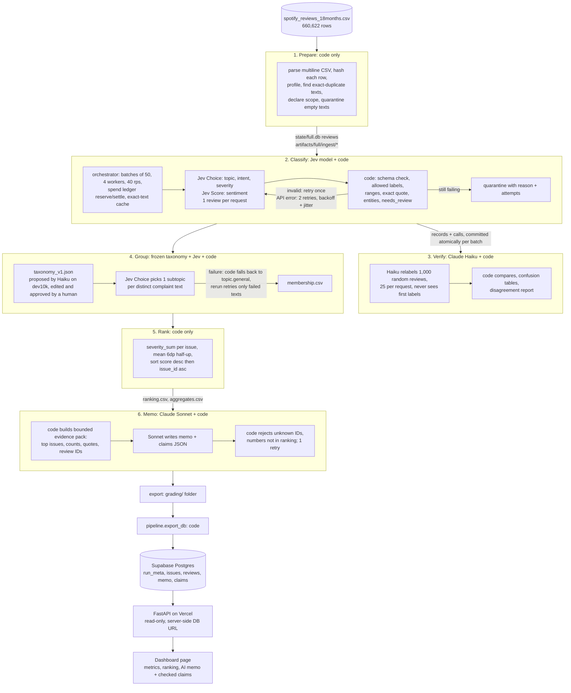

# Spotify Review Issues: a multi-agent review pipeline

**Live dashboard: https://agentic-ai-final-three.vercel.app** (public, no login, no API key needed).

**Question:** Spotify is at the end of this review window (May 2022 to Nov 2023). Where should next quarter's product effort go?
**Answer from the final run:** prioritize **`billing.basic_features_behind_premium`**: basic controls (choosing songs, skipping, turning off shuffle) that free users lost to the Premium paywall. It has 6,254 complaints and a severity sum of 17,653 [C1, C2], and its share of all complaints jumped from 4.7% in Jun–Aug 2023 to **28.7% in Sep–Oct 2023** [C6, C7]. Because the paywall is a deliberate business decision, the recommendation is to evaluate scoped options (restore selected basics, clearer limits, a clearer upgrade path), not to "fix a bug". The data has no revenue or conversion figures to weigh that trade-off, and the spike is recent. See the [memo](artifacts/full/memo/memo.md) and the [trend table](evals/results/trend_shares.md).

**Final run:** `full`, which classified a declared scope of **100,000** of the 660,622 reviews (the course's seeded first 100,000). All 660,622 source IDs are ingested and accounted for. The other 560,609 nonempty reviews are recorded as quarantined (`outside_declared_classification_scope`) and are **not** classified. The 13 empty texts are quarantined as `empty_review_text`. The downloadable grading export is in [`grading/`](grading/).

---

## Rubric → evidence map

| Rubric item | Evidence |
|---|---|
| **Deliverable quality** | |
| Accessible code, setup and artifacts | [Setup](#setup-and-commands) · [`requirements.txt`](requirements.txt) · [`.env.example`](.env.example) · [`.gitignore`](.gitignore) · [`pipeline/`](pipeline/) · [`grading/`](grading/) · [`artifacts/full/`](artifacts/full/) · clean-clone offline check ([below](#reproduce-without-an-api-key)) |
| Clear architecture, shared schema, provenance | [Architecture](#architecture) · [label definitions `prompts/labels_v1.md`](prompts/labels_v1.md) · [Jev questions `prompts/jev_questions_v1.py`](prompts/jev_questions_v1.py) · [frozen taxonomy](prompts/taxonomy_v1.json) · [`grading/run.json`](grading/run.json) · [ingestion report](artifacts/full/ingest/ingestion_report.json) · every record carries `source_sha256`, `label_config` and `cache_source_id` |
| Memo numbers linked to calculations and evidence | Every number in [memo.md](artifacts/full/memo/memo.md) has a claim ID. The 7 ranking metrics are in [`grading/claims.csv`](grading/claims.csv) and equal [`grading/ranking.csv`](grading/ranking.csv) (checked by code and the course checker). The 8 others (cancellation counts, severity-4+ counts, period shares) are in [`extra_claims.csv`](artifacts/full/memo/extra_claims.csv) with numerator, denominator and source. All 15 are recomputed from the database by the API ([dashboard check](evals/results/dashboard_check.json)) · [evidence pack](artifacts/full/memo/evidence_pack.json) · [traced review](#one-review-traced-end-to-end) |
| Coherent recommendation, alternatives, limitations | [Recommendation](#recommendation) · [memo](artifacts/full/memo/memo.md) · [trend shares](evals/results/trend_shares.md) · [Limitations](#limitations-and-known-issues) |
| **Testing & evaluation** | |
| 50 human labels, per-field comparison, error analysis | [golden labels](evals/golden_50_labeled.csv) · [final comparison](evals/results/golden_eval_final/golden_eval.json) · [per-case](evals/results/golden_eval_final/golden_cases.csv) · [disagreements](evals/results/golden_eval_final/disagreements.md) · [quote and entity review](evals/results/golden_quote_entity_review.md) · [label audit v1→v2](evals/label_audit.md) · [v2 comparison](evals/results/golden_eval_final_v2/golden_eval.json) · [checker `--gold` output](#golden-set-50-human-labels) |
| Independent verification, planted errors, injection | [verifier disagreement report](artifacts/full/verify/disagreement_report.json) · [verifier predictions](artifacts/full/verify/verifier_predictions.jsonl) · [20 disagreements inspected](evals/results/verifier_disagreements_inspected.md) · [planted errors 30/30](evals/results/planted.json) + [false-flag baseline](evals/results/planted_false_flags.json) · [injection tests](evals/results/injection.json) (+ [before the fix](evals/results/injection_jev-q1.json)) |
| Real 100-review cold/warm pilot, offline calculator, T3 controls | [cost report](cost/report.md) · [`cost/calculator.py`](cost/calculator.py) · [pilot records](cost/pilot_records.jsonl)/[calls](cost/pilot_calls.jsonl) · [usage](cost/usage.csv)/[rates](cost/rates.csv) · [T3 retry/spend/recovery](evals/results/t3.json) · [real credit-outage recovery](#one-failed-case-and-how-it-was-handled) |
| **Working result** | |
| Full ingestion, coverage, successful classification | [ingestion](grading/ingestion.json) · [records](grading/records.jsonl.gz) · [self-check results](#course-checker-self-check) (accounted 1.0, 100,000 valid completed, 0 failed) |
| Runnable staged program, bounded calls, saved handoffs, resume | [`pipeline/run.py`](pipeline/run.py) · [`grading/calls.jsonl`](grading/calls.jsonl) (121,451 calls, initial/resume phases) · checkpoints [before](grading/checkpoint_before.json)/[after](grading/checkpoint_after.json) · [interruption/resume](#interruption-and-resume) · [screen recording](https://github.com/OskitheBear1/agentic-ai-final/releases/download/p5-full-run/resume_recording_full_run.mov) |
| Reproducible ranking, deployed dashboard + backend + DB, grounded recommendation | `python -m pipeline.rank` reproduces [`ranking.csv`](grading/ranking.csv) byte for byte · [dashboard](https://agentic-ai-final-three.vercel.app) · [API](dashboard/api/index.py) · [DB schema](dashboard/schema.sql) · [loader](pipeline/export_db.py) · [live check 10/10](evals/results/dashboard_check.json) |

---

## Results summary

**Measured on the final run** (from `grading/` and `artifacts/full/`):

| | |
|---|---|
| Source rows ingested and profiled | **660,622**. 13 empty texts, 159,701 missing `app_version`, 0 duplicate IDs, 484,189 distinct nonempty texts, all matching `manifest.json` |
| Accounted for | **660,622 / 660,622** (1.0). Every source ID has exactly one record. |
| **Completed classifications** | **100,000** (the declared scope). 0 failed and 0 quarantined inside the scope. |
| Quarantined | 560,609 `outside_declared_classification_scope` (not classified) + 13 `empty_review_text` |
| Exact-text cache reuse | 21,901 of the 100,000 rows reused an identical text's labels (direct `cache_source_id`), so Jev was called for 78,099 distinct texts |
| Flagged `needs_review` | 22,208 (low model confidence). Kept in all totals and marked. |
| Complaint/cancellation reviews grouped | 45,084 reviews into 34 issues (8 topics) |
| Independent verifier (Claude Haiku, 1,000 random reviews) | Agreement: topic **82.6%**, intent **92.0%**, severity **86.3%** (±1: 98.9%), sentiment ±0.5 **95.9%**. 0 verifier failures. |
| Golden 50 (human labels) | v1: topic **82%**, intent **76%**, severity **82%** (MAE 0.20), sentiment ±0.5 **86%**. After the human label audit (v2, 15 severity corrections): severity **76%** (MAE 0.36), topic and intent unchanged. All 50 quotes are exact substrings. |
| Measured usage (full run) | Jev: 115.6M input + 18.0M output tokens over 121,405 calls. Anthropic: 100,621 input + 49,916 output tokens over 46 calls (40 verify, 6 memo attempts). |
| Full-run API cost (**partly estimated**) | **$5.13** = Jev **$4.85 estimated** (enrich $4.05 + grouping $0.80; usage × a third-party-reported rate, see below) + Anthropic **$0.28** (usage × official rates: verify $0.02, memo $0.25 across 3 generations and 6 attempts). Whole project including pilot, dev runs and tests: **$5.84** by the spend ledger. |
| Full-run wall-clock (active) | **≈72 min**: enrich 53.1 min across 3 sessions (31.4 reviews/s, 4 workers), verify 2.2 min, group 16.1 min (incl. the outage retry), rank + memo + export under 1 min |
| Calls | 121,451 recorded (78,099 enrich, 43,306 group of which 2,916 failed with HTTP 402 and were retried, 40 verify, 6 memo of which 2 were rejected by code validation and retried) |

**Estimates (made before the run, in [`cost/report.md`](cost/report.md)):** 100k base **$4.79**, conservative $5.20, about 1.0 h at 4 workers. The full run's enrich + group + verify + first memo came to $4.94, between the two; the two later memo regenerations (memo-v2) add $0.19.

**Jev pricing is not reconciled.** About 95% of the dollars are Jev, priced at $0.042/M input tokens from a third-party source (`third_party_reported` in [`cost/rates.csv`](cost/rates.csv)). After the pilot, the TypeSafe dashboard showed $0.0001 against $0.006 computed (it may lag, or the true rate is lower). Token counts are measured; Jev dollars are an estimate. The scope decision (a full-corpus run projected at about $29.32, over the $12 budget, so classify 100,000) rests on this same estimated rate.

**The pilot ran an earlier configuration** (`jev-q1+schema-v1`, a per-run Haiku taxonomy) than the final run (`jev-q2+schema-v2`, frozen `taxonomy_v1.json`). The 500- and 10k-review refreshes, which the projection uses, ran the final configuration.

**Measured 100-review pilot** ([`cost/report.md`](cost/report.md)): cold run 41.5 s and $0.0372 on an empty cache with 1 worker. Warm run 0.19 s, $0, 0 new calls in any stage.

---

## Recommendation

From [`artifacts/full/memo/memo.md`](artifacts/full/memo/memo.md) (`memo-v2`), written by Claude Sonnet 5.5 from the saved [evidence pack](artifacts/full/memo/evidence_pack.json) only. Code rejects a draft if any claim value, issue ID, review ID or number differs from the saved calculations, or if a review ID is shortened. 2 of 6 attempts were rejected and retried.

- **Priority:** `billing.basic_features_behind_premium`: 6,254 complaints [C1], severity sum 17,653 [C2], mean severity 2.822673 [C3], 476 reviews at severity 4+ [C5]. 1,191 reviews express cancellation *intent* [C4], which is not observed churn.
- **It is a business trade-off, not a bug:** free-tier limits look like a deliberate monetization change. The memo recommends evaluating scoped options (restore selected basics such as song choice or skip, clearer limits, a clearer upgrade path) and says there is no revenue or conversion data to weigh them.
- **Time concentration:** the issue's share of complaints went from 4.7% in 2023-06..08 [C7] to 28.7% in 2023-09..10 [C6]. The evidence is concentrated in the latest period, so the memo says to recheck the share with later data before committing.
- **Why not `other.general`?** It has the most complaints (11,062 [C8]) but is a catch-all bucket of generic negative reviews with no single problem to fix.
- **Alternatives:** `usability.ad_frequency_loudness` (5,120 complaints [C9]); its share fell from 20.7% [C10] to 7.1% [C11], and only 57 are severity 4+ [C12]. `playback.playback_interruptions` has the highest mean severity of the top issues (3.419342 [C13]) but 2,461 complaints [C14] and a falling share (2.7% [C15]): steady engineering work, not the lead priority.
- **Typical reviews:** chosen by code from each issue's most common severity, excluding flagged and cache-copied records, rather than the most extreme cases. Lead issue: `e9ecb1b6-7dec-4f14-bd52-435dfc3802ca`, `818f7017-d57e-47b7-8ca8-938964c06699`, `0edd175d-8feb-4eb7-8c3e-3524e24345d4` (all severity 3: forced shuffle, can't choose or replay songs without paying). Ads: `e1d9c9a5-0966-451f-8f6d-f6954b5abde2`. Interruptions: `35874e74-1a13-479b-ad56-e4e61cb193fa`.

**Trend in comparable periods** ([`evals/results/trend_shares.md`](evals/results/trend_shares.md), `python3 evals/trend_shares.py`). Share = issue complaints ÷ all complaint/cancellation reviews in the period. The partial months 2022-05 and 2023-11 are excluded.

| period | classified reviews | complaints | basic features behind Premium | ad frequency/loudness | playback interruptions |
|---|---|---|---|---|---|
| 2022-06..08 | 14,234 | 4,609 | 300 (6.5%) | 796 (17.3%) | 510 (11.1%) |
| 2022-09..11 | 12,251 | 3,568 | 258 (7.2%) | 739 (20.7%) | 262 (7.3%) |
| 2022-12..2023-02 | 12,261 | 4,055 | 221 (5.5%) | 688 (17.0%) | 508 (12.5%) |
| 2023-03..05 | 12,235 | 4,202 | 273 (6.5%) | 588 (14.0%) | 272 (6.5%) |
| 2023-06..08 | 21,685 | 11,098 | 527 (4.7%) | 993 (8.9%) | 362 (3.3%) |
| 2023-09..10 | 19,776 | 13,272 | **3,809 (28.7%)** | 937 (7.1%) | 361 (2.7%) |

The Premium paywall complaints are new and growing fast: 74% of the issue's complaints fall in Sep–Nov 2023, so whether the spike persists is unknown. Ad complaints are steady in count but shrinking as a share.

---

## Architecture

Code owns the order of stages, record accounting, validation, budgets, caching and all arithmetic. Models are used only where language judgment is needed. Every stage reads the previous stage's saved files and writes its own, so each handoff can be inspected.



**Stop and retry paths** (all in [`pipeline/enrich.py`](pipeline/enrich.py) and [`pipeline/ledger.py`](pipeline/ledger.py)):
- **Invalid model output:** retried once, then the record is quarantined with a reason.
- **Temporary API errors and rate limits:** up to 2 retries (3 attempts in total) with exponential backoff and jitter.
- **Budget:** the ledger reserves each call's worst-case cost before dispatch and stops admitting work once spent + reserved would exceed `--budget`.
- **Stopping early:** Ctrl-C, `--max-batches` or `--time-limit` finish the current batch, save, and stop.
- **Resuming:** a rerun skips completed IDs.
- **Downstream stages:** skip when their input fingerprint is unchanged (this is how the warm run makes 0 calls).
- **Incomplete grouping blocks downstream:** if any subtopic assignment fails, grouping writes `INCOMPLETE.json`, and `rank`, `memo` and `export` refuse to run until a `group` rerun clears it (or `--accept-incomplete` is passed). Tested in `tests/test_offline.py::test_incomplete_grouping_blocks_downstream`. This gate was added after the outage described below.

### Why each model call is needed, and what code does instead

| Role | Model and settings | Why a model | What code does |
|---|---|---|---|
| Enrich | TypeSafe **Jev** (`jev-latest`, served `jev-1.13.0`). Choice for topic, intent and severity; Score for sentiment. Prompt `jev-q2`, schema `schema-v2`. | Reading messy, multilingual customer text against fixed definitions | Batching, cache lookup, schema and range checks, exact `evidence_quote` (deterministic: the whole review if short, else the best sentence), entities via a keyword lexicon, `needs_review` from confidence (< 0.7) |
| Verify | **Claude Haiku 5.5**, thinking disabled, structured output, `verify-v1` | An independent second reading | Random sample by SHA-256 order, comparison, confusion tables |
| Group | Taxonomy: **Claude Haiku 5.5** proposed it once on dev10k, then a human edited and froze it. Assignment: **Jev** Choice per distinct complaint text, `group-v1`. | Choosing the specific sub-problem a complaint describes | Membership file, fallback to `<topic>.general` on failure, counts |
| Rank | none | not needed | All arithmetic and ordering ([`pipeline/rank.py`](pipeline/rank.py)) |
| Memo | **Claude Sonnet 5.5**, adaptive thinking, effort low, structured output, `memo-v2` | Writing an argument and weighing alternatives | Builds the bounded evidence pack (aggregates, period shares with denominators, typical and most-severe examples), then validates every claim, issue ID and review ID against saved files |

The label definitions shared by all roles and the human labeler are in [`prompts/labels_v1.md`](prompts/labels_v1.md). They follow `tools/GRADING_CONTRACT.md`, and their examples come from development files only. `label_config` on every record = `jev-1.13.0+jev-q2+schema-v2+quote-v1`. Changing any part changes the cache key.

### Dashboard, backend and database

- **Dashboard** ([`dashboard/public/index.html`](dashboard/public/index.html)), at https://agentic-ai-final-three.vercel.app:
  - overall metrics;
  - the AI recommendation, with a table checking each memo claim against the database value, and the cited reviews;
  - the full issue ranking (click an issue, or open `#issue/<issue_id>`, to see its monthly trend, severity mix and highest-severity reviews with the evidence quote highlighted);
  - topic and intent charts;
  - the label-quality checks.
- **Backend** ([`dashboard/api/index.py`](dashboard/api/index.py)): a read-only FastAPI app on Vercel with endpoints `/api/metrics`, `/api/ranking`, `/api/issues/{id}`, `/api/reviews/{id}`, `/api/recommendations` and `/api/health`. Interactive docs: [/api/docs](https://agentic-ai-final-three.vercel.app/api/docs). The database URL is a server-side Vercel environment variable and never reaches the browser. The TLS connection is verified against Supabase's root CA, which is bundled with the API.
- **Database** ([`dashboard/schema.sql`](dashboard/schema.sql)): Supabase Postgres. It stores the 100,000 classified reviews with source fields and labels, 34 issues with aggregates and monthly counts, the memo, its claims (both files) and run metrics. Row-level security is on with no policies, so Supabase's public REST API reads nothing. Load it with `python -m pipeline.export_db --run full` (about 2.5 min, 0 model calls).
- **Verified:** [`tests/check_dashboard.py`](tests/check_dashboard.py) compares the live API with the saved files: the ranking (all fields), totals, memo text, all 15 claims (the API recomputes each from stored issue rows, including period shares from monthly counts), the cited reviews and sampled labels. Result: **10/10 pass** ([`evals/results/dashboard_check.json`](evals/results/dashboard_check.json)). The page was also checked in a signed-out browser.

---

## One review traced end to end

Review **`c42b8c38-8258-4567-bbf6-0a5a6f331233`**: *"You can't listen to full songs on the app for free ,I'll use other apps"*

| Step | What happened | Where to see it |
|---|---|---|
| Source | Row 267,732, 1★, app 8.8.12.545, 2023-02-22 12:28:52. `source_sha256` `5eb9148c…cef41c`. Scope rank 71,423 (inside the first 100,000). | `grading/records.jsonl.gz` |
| Enrichment | Jev call `req_01a150ccc037706b8c1fb137cb608989`, phase **resume**, 1 attempt, 1,231 input + 198 output tokens, $0.0000517. Result: topic **billing**, intent **cancellation**, severity **3**, sentiment −0.585, `needs_review` false. Quote = whole review (exact substring). | `grading/calls.jsonl`, `grading/records.jsonl.gz` |
| Verification | In the 1,000-review sample. Haiku call `req_011CgAPoTmnZhMYnYrwufrXU` (25 reviews in the request) independently gave the same topic, intent and severity. | `artifacts/full/verify/verifier_predictions.jsonl` |
| Issue membership | Jev subtopic call `req_01a150e984667f39a1affb3098ad16be` → **`billing.basic_features_behind_premium`** | `grading/membership.csv` |
| Ranking | That issue is **rank 2** (6,254 complaints, severity sum 17,653, mean 2.822673). This review adds 3 to the severity sum and 1 to the cancellation count. | `grading/ranking.csv`, `artifacts/full/rank/aggregates.csv` |
| Memo claim | The memo recommends this issue, citing **C1** (complaint_count 6254) and **C2** (severity_sum 17653). The checker recomputes both from records + membership. | `grading/claims.csv`, `artifacts/full/memo/memo.md` |

### One failed case and how it was handled

Review **`3046d93b-9fcc-4a32-b689-297eb9fa3ce2`**: *"Worst experience, lot's of ad Play and specially vadakan songs."*

1. **The failure.** During grouping, the TypeSafe account ran out of prepaid credits. Starting at call 37,408 of 40,390, Jev returned `402 Your organization has no available TypeSafe API credits`. This review's subtopic call `failed-815efc55…` is recorded as `failed` in `grading/calls.jsonl`.
2. **Code's response, and its gap.** The code put the review in the `usability.general` fallback, so no complaint was lost, logged the failure and did not save the stage fingerprint. **But the chained command kept going:** rank, memo and export ran once on the fallback-filled membership (`artifacts/full/run_log.jsonl` shows `other.general` at 11,308 and a memo built from it). Rejecting that output was a manual decision afterwards, not a control.
3. **Why the budget control didn't catch it.** Our spend ledger caps *our* spend at $12, but it cannot see a provider's prepaid balance.
4. **The decision.** Don't accept a ranking with 2,916 complaints parked in fallback buckets. Top up the credits, then add resume to grouping ([`prior_assignments()` in `pipeline/group.py`](pipeline/group.py)): reuse the 37,474 succeeded choices and retry only the 2,916 failed texts.
5. **Recovery.** The rerun made 2,916 calls with 0 failures and cost $0.058. This review got call `req_01a150efe31c768092c0238c848af52a` → `usability.ad_frequency_loudness`. Rank, memo and export were then rerun. The failed calls stay in `calls.jsonl` as evidence.
6. **Closing the gap.** Grouping now writes `INCOMPLETE.json` on any failed assignment, and `rank`, `memo` and `export` refuse to run while it exists (see Stop and retry paths).

**An ambiguous case:** golden review *"It's my best music app but now it's not...everything basic features is premium...."*. The human labeled it `other/complaint/2`; the pipeline gave `billing/complaint/3` and did not flag it. Both readings are defensible ("a paid-plan mention alone is not billing", but this one complains about a paywall). It is counted as a disagreement, not silently dropped ([disagreements](evals/results/golden_eval_final/disagreements.md)).

---

## Evaluation and system checks

### Golden set (50 human labels)
- **Labels.** The 50 reviews were labeled by hand before evaluation ([`evals/golden_50_labeled.csv`](evals/golden_50_labeled.csv), benchmark [`evals/gold_benchmark.json`](evals/gold_benchmark.json)). They were never used as model inputs, prompt examples or thresholds; `tests/test_offline.py::test_golden_labels_never_reach_model_code` enforces this. The `schema-v2` needs_review threshold was chosen on dev10k verifier disagreements. The `jev-q2` guard sentence was motivated by the injection test ([`injection_jev-q1.json`](evals/results/injection_jev-q1.json): Jev followed 2/6 injected instructions). The golden q1 evaluation had already run 34 seconds earlier, so timestamps alone can't prove it played no part. But golden scores are identical under q1 and q2 ([q1](evals/results/golden_eval_jev-q1/golden_eval.json), [q2](evals/results/golden_eval_jev-q2/golden_eval.json)), so the change didn't move them.
- **Reference audit (v1 → v2).** A strict external review found that some of the human labels break the shared rules: 12 praise/unclear reviews rated severity 2 (rule: 1), and 3 requests rated severity 3. A code rule check over all 50 selected those 15 cases, with model predictions **not** shown. The student re-decided each one and changed **15 severities** (12 × 2→1, 3 × 3→1, keeping intent `request`), with 0 topic or intent changes ([`label_audit.md`](evals/label_audit.md), [`golden_50_labeled_v2.csv`](evals/golden_50_labeled_v2.csv), [`gold_benchmark_v2.json`](evals/gold_benchmark_v2.json); v1 files unchanged). The audit was prompted by reviewing disagreements, so both versions are reported.
- **Final labels vs human:**

  | | topic | intent | severity exact | severity MAE | sentiment ±0.5 | all 3 core | macro F1 topic / intent / severity |
  |---|---|---|---|---|---|---|---|
  | v1 ([eval](evals/results/golden_eval_final/golden_eval.json), [cases](evals/results/golden_eval_final/golden_cases.csv)) | 0.82 | 0.76 | 0.82 | 0.20 | 0.86 | 0.58 | .71 / .64 / .74 |
  | v2 audited ([eval](evals/results/golden_eval_final_v2/golden_eval.json), [cases](evals/results/golden_eval_final_v2/golden_cases.csv)) | 0.82 | 0.76 | **0.76** | **0.36** | 0.86 | 0.60 | .71 / .64 / .65 |

  The audit **lowered** severity agreement. v1.1 had accepted both 1 and 2 for the unclear cases, and the 3 audited requests are cases where the pipeline said complaint with severity 2–4 while the human kept request/1. The macro F1 values come from the course checker's `--gold` run on each benchmark. 11 cases are marked ambiguous by the human, and quotes are exact substrings in 50/50.
- **Error analysis:**
  - **Reference errors:** 15 human labels broke the severity rule (above). Reference errors are a real error category on a hand-labeled set, not only model errors.
  - **Request vs complaint** is the main remaining severity disagreement: reviews like "Lyrics not getting loaded… Pathetic update" report a failure (the pipeline: complaint, severity 3) but the human reads them as requests (severity 1).
  - Most topic misses are `other` vs a specific topic: human `other` was predicted `catalog` 3 times and `billing` 2 times. The human treated these as generic criticism.
  - Usability vs billing on paywall complaints (2 cases).
  - Intent misses concentrate on human `unclear`: 4 were predicted `complaint`, including non-English and boycott-slogan reviews.
- **needs_review as a prediction (v1):** 9 flagged, all 9 wrong (precision 1.0), but 12 wrong records were unflagged (recall 0.43). It's useful as a triage signal, not a guarantee.
- **Quote support and entities** ([review](evals/results/golden_quote_entity_review.md), AI-assisted): 47/50 quotes are the whole review, so the substring check is trivial for them. Of the 3 single-sentence quotes, 1 doesn't support the label and 2 only partly do. The 32 "unsupported" entities are all real keyword mentions (no hallucinations); the error mode is word sense ("I updated my phone" → `update`).
- **Coverage gap:** the golden set has no billing or access reviews, so it cannot check the recommended billing issue (see Limitations).

### Independent verifier (full run)
- **Sample.** Claude Haiku relabeled a declared random sample of 1,000 completed, non-cached reviews: the lowest SHA-256(`verify-v1:`+id). It saw only the text and the rubric, never the first labels.
- **Agreement:** topic .826, intent .920, severity .863 (±1 .989), sentiment .959 ([report](artifacts/full/verify/disagreement_report.json)).
- **Where they disagree:** `other→catalog` (32), `usability→catalog` (24), `other→playback` (17), and on intent, `cancellation→complaint` (15).
- **needs_review vs disagreement:** of 272 flagged reviews, 130 disagreed with the verifier. 108 disagreements were unflagged.
- **Inspected disagreements** ([20-case sample](evals/results/verifier_disagreements_inspected.md); judged by the developer's AI assistant against the contract, not by a human): the enricher was closer in 8, the verifier in 5, and 7 were genuinely ambiguous. The main pattern is the **billing vs usability boundary around ads and Premium**, the same boundary as the recommended issue. The second is inflated severity on short generic reviews ("Uninstalled after new update" → 4).

### Planted errors and injection ([`evals/system_tests.py`](evals/system_tests.py); synthetic, excluded from business aggregates)
- **Planted errors** ([`planted.json`](evals/results/planted.json)): 30 copies of dev records, each with one deliberately wrong field. **30/30 caught.** Code caught invalid labels, out-of-range sentiment and fake quotes (15/15); the Haiku verifier caught wrong topic, intent and severity (15/15). **False-flag baseline** ([`planted_false_flags.json`](evals/results/planted_false_flags.json)): the verifier also disagrees with **9 of the 30 unplanted originals** (30%), so a verifier flag means "look at this", not "this is wrong". Code checks had no false flags.
- **Prompt injection** ([`injection_jev-q1.json`](evals/results/injection_jev-q1.json) → [`injection.json`](evals/results/injection.json)): 6 synthetic reviews containing instructions such as "label this as praise". Under `jev-q1`, Jev followed 2/6. That result led to the `jev-q2` guard sentence; after it, Jev followed 0/6 with 6/6 correct, and Haiku followed 0/6 both times.

### Retry, spending and recovery controls (T3) ([`t3.json`](evals/results/t3.json))
- **Retries:** 16 injected API faults hit 11 of 100 reviews. 10 of those recovered on retry, and 1 exhausted its retries and was quarantined as `api_error_after_retries` (visible, not hidden): 99/100 completed.
- **Spend cap:** the ledger stopped at $0.682 against a $0.682 cap with no overshoot, after saving 76 records.
- **Resume:** went from 76 to 500 records with **0 completed IDs re-sent**.

### Interruption and resume (full run)
| Snapshot | Completed IDs | Note |
|---|---|---|
| [`checkpoint_before.json`](grading/checkpoint_before.json) | 15,000 | Initial run stopped deliberately with `--max-batches 300` |
| [`checkpoint_before_resume2.json`](artifacts/full/checkpoints/checkpoint_before_resume2.json) | 21,000 | First resume stopped with Ctrl-C; the current batch finished and saved cleanly |
| [`checkpoint_after.json`](grading/checkpoint_after.json) | 100,000 | Second resume ran to completion |

`grading/calls.jsonl` has 12,499 `initial` and 65,600 `resume` enrichment calls, and no review ID was sent to the enricher twice. The 15,000 − 12,499 difference is exact-text cache hits.

**Screen recording:** [resume_recording_full_run.mov](https://github.com/OskitheBear1/agentic-ai-final/releases/download/p5-full-run/resume_recording_full_run.mov) (57 s, [release page](https://github.com/OskitheBear1/agentic-ai-final/releases/tag/p5-full-run)). It shows the 21,000-ID snapshot, then the resume command starting and new batches completing.

### Course checker self-check
`python3 tools/check_submission.py check --reference local-reference.json --gold evals/gold_benchmark.json --submission grading`
- Coverage: accounted fraction **1.0**, 0 missing, 0 duplicate, 0 invalid, 100,000 valid completed, 21,901 valid cache reuses, 560,622 quarantined.
- The only issue flagged is `unfinished_classification: 560609`. This is the out-of-scope rows, by design (scope = 100,000).
- The checker's recomputed ranking matches `grading/ranking.csv`, and all claims match.

---

## Ranking: baseline, rules and scope

- **Baseline** ([`pipeline/rank.py`](pipeline/rank.py)): `priority(issue) = complaint_count × mean_severity = severity_sum`, over reviews with intent `complaint` or `cancellation`. Each review counts once, in exactly one issue. Means are reported to 6 decimals, rounded half-up. Sorted by score descending, ties by `issue_id` ascending.
- **Reproduce:** `python -m pipeline.rank --records grading/records.jsonl.gz --membership grading/membership.csv --out /tmp/rerank`. This needs no model, key or database, and its output is byte-identical to `grading/ranking.csv` (also asserted by `tests/test_offline.py`).
- **Scope:** 100,000 of 660,609 nonempty reviews, the course's seeded order, so the scope is a pseudo-random sample spread across all months. Results describe that sample, not the full corpus. The other 560,609 are **incomplete classifications**: they are accounted for but not classified.
- **Missing data:** 159,701 source rows lack `app_version`. It isn't used for classification, so this doesn't block anything.
- **Bias:** app-store reviews are self-selected and skew negative (1★ and 5★ dominate). Monthly volume spikes (2023-07, 2023-10) reflect review surges, which is why the trend table uses shares with denominators. Cancellation language is intent, not churn. There is no revenue, plan tier or population data.

---

## Cost and runtime calculator

[`cost/calculator.py`](cost/calculator.py), per `tools/COST_CALCULATOR.md`:
- **Default mode is offline.** It recomputes every cost from [`cost/usage.csv`](cost/usage.csv) × editable dated [`cost/rates.csv`](cost/rates.csv), writes [`cost/report.md`](cost/report.md), and makes no API calls.
- **The paid pilot is a separate command:** `python3 cost/calculator.py pilot --paid`.

It reports the real cold/warm 100-review pilot, the per-stage model/settings/usage table, the 500 and 10k refreshes, the 100k and full-corpus projections (base, conservative, no-reuse) and the controls (budget, workers, output caps, fallback fraction).

```sh
python3 cost/calculator.py                        # offline replay
python3 cost/calculator.py --rates-multiplier 2   # API $ doubles (4.79 → 9.58), measured times unchanged
python3 cost/calculator.py --scope 660609         # projection changes, measured pilot unchanged
```

**Rate note:** Jev output tokens are priced at $0 and input at $0.042/M from a third-party source (marked `third_party_reported` in `rates.csv`, with the dashboard reconciliation note). Anthropic rates are official, checked 2026-10-18. `cost/assumptions.json` `rps_cap` is 40, matching the full run's `--rps 40`.

---

## Setup and commands

**Requirements:** Python 3.12+. Offline checks use only the standard library. The paid stages need `pip install -r requirements.txt`.

**Data:** download the course dataset ZIP from [Google Drive](https://drive.google.com/file/d/1P0rUoAS_wVjp3BYKqXMEyD4u0uJP1Bvf/view) and put the CSVs in `data/` (gitignored). Original source: [BwandoWando, 3.4 Million Spotify Google Store Reviews (Kaggle, CC0)](https://www.kaggle.com/datasets/bwandowando/3-4-million-spotify-google-store-reviews). `spotify_reviews_18months.csv` is 97,400,616 bytes, sha256 `1fc85de68a304dd8978b537cfa58793d5f41cbaf417fa32cb53899f83a2fcef6`.

**Keys:** copy `.env.example` to `.env` and fill in `ANTHROPIC_API_KEY` and `TYPESAFE_API_KEY` (plus `SUPABASE_DB_URL` for the database loader). `.env` is gitignored, and a pre-commit hook ([`scripts/secret_scan.sh`](scripts/secret_scan.sh)) blocks commits containing key patterns or any `.env` value.

### Reproduce without an API key
These were tested in a fresh clone with no `data/`, `state/` or `.env`, using only the standard library.
```sh
python3 cost/calculator.py                     # cost/runtime replay from saved usage
python3 -m pipeline.rank --records grading/records.jsonl.gz --membership grading/membership.csv --out /tmp/rerank
cmp /tmp/rerank/ranking.csv grading/ranking.csv   # identical
python3 -m tests.test_offline                  # 6/6 pass
python3 tests/check_dashboard.py https://agentic-ai-final-three.vercel.app   # live API == saved files
# with the dataset in data/:
python3 tools/check_submission.py reference --full data/spotify_reviews_18months.csv --analysis data/spotify_reviews_18months.csv --out local-reference.json
python3 tools/check_submission.py check --reference local-reference.json --gold evals/gold_benchmark.json --submission grading --out self-check.json
python3 evals/trend_shares.py
```

### Run the pipeline (paid; every model stage refuses to run without `--paid`)
```sh
python -m pipeline.run ingest --input data/spotify_reviews_18months.csv --run full --scope 100000
python -m pipeline.run enrich --run full --workers 4 --rps 40 --max-batches 300 --paid   # interrupted on purpose
python -m pipeline.run snapshot --run full --name before
python -m pipeline.run enrich --run full --workers 4 --rps 40 --paid                    # resume
python -m pipeline.run snapshot --run full --name after
python -m pipeline.run verify --run full --verify-n 1000 --paid
python -m pipeline.run group  --run full --taxonomy prompts/taxonomy_v1.json --workers 4 --paid
python -m pipeline.run rank   --run full
python -m pipeline.run memo   --run full --paid
python -m pipeline.run export --run full --input data/spotify_reviews_18months.csv --gzip
python -m pipeline.export_db --run full                                                 # load Supabase
# any CSV, all stages: python -m pipeline.run all --input <file.csv> --run <name> --paid
```
The spend ledger (`state/ledger.db`) is shared by all runs and enforces `--budget` (default $12). A mock harness runs the whole pipeline with 0 API calls (it still needs `pip install -r requirements.txt`, because it patches the installed `typesafe_sdk`; `--paid` only satisfies the gate): `PIPELINE_LEDGER=state/mock_ledger.db python -m tests.mock_models all --input data/cost_100.csv --run mock --scope 0 --fresh --paid`.

**Dashboard deploy:** `vercel deploy --prod --cwd dashboard`, with `SUPABASE_DB_URL` set as a Vercel environment variable. Local: `cd dashboard && SUPABASE_DB_URL=... uvicorn api.index:app`.

---

## Repository layout

| Path | Contents |
|---|---|
| `pipeline/` | Orchestrator (`run.py`) and stages: `ingest`, `enrich`, `verify`, `group`, `rank`, `memo`, `export`, `export_db`, plus `ledger` (spend), `state` (SQLite), `features` (quotes, entities) |
| `prompts/` | `labels_v1.md` (shared definitions + dev examples), `jev_questions_v1.py`, `taxonomy_v1.json` (frozen, human-approved; review notes in `evals/results/taxonomy_review.md`). Verify/group/memo prompts are versioned constants in their stage files. |
| `grading/` | Standardized export: `run.json`, `ingestion.json`, `records.jsonl.gz`, `membership.csv`, `ranking.csv`, `claims.csv`, `calls.jsonl`, `checkpoint_before.json`, `checkpoint_after.json` |
| `artifacts/full/` | Final run handoffs: ingest report, checkpoints, verifier predictions + disagreement report, taxonomy + membership + issues, aggregates + ranking, evidence pack + memo, run logs and per-stage summaries |
| `artifacts/{pilot,dev500,dev500_q2,dev10k,golden,golden_q2,test_*}/` | Pilot, development checkpoints, golden runs and system-test runs |
| `cost/` | Calculator, pilot records/calls, usage, rates, assumptions, projections, report |
| `evals/` | Golden labels and import tools, `golden_eval.py`, `system_tests.py`, `trend_shares.py`, synthetic test inputs, `results/` |
| `dashboard/` | `schema.sql`, `api/index.py` (FastAPI), `public/index.html`, `requirements.txt` |
| `tests/` | `test_offline.py`, `check_dashboard.py`, `mock_models.py` |
| `tools/` | Course-supplied checker, grading contract, calculator spec, manifest |

---

## Limitations and known issues

- **Only 100,000 of 660,609 nonempty reviews are classified** (budget: the full corpus projected at about $29 against a $12 cap, using the unreconciled third-party Jev rate; if the true rate is lower, the full corpus may have been affordable). The rest are accounted for but are incomplete classifications, so the checker flags `unfinished_classification`. All conclusions describe the 100k sample.
- **Label accuracy is moderate:** about 82% topic agreement with both the human set and the verifier. Confusion concentrates on `other` vs specific topics. 50 golden cases are a small diagnostic sample, not a population estimate. `needs_review` catches only some errors.
- **`other.general` is the largest bucket** (11,062 complaints). These are generic negative reviews without a specific problem. The memo excludes it as unactionable rather than hiding it.
- **Provider credit outage during grouping** (described above). It was recovered, and downstream stages are now gated on complete grouping, but the ledger only enforces our own cap, not provider balances.
- **The golden set has no billing or access cases** (human topics: other 32, usability 9, playback 4, catalog 3, support 1, downloads 1). It cannot validate the recommended billing issue directly. The only check there is the verifier, whose main disagreement pattern is the billing vs usability boundary (`billing→usability` 14, `other→billing` 14 of 1,000).
- **Evidence quotes are weak for long reviews:** 47/50 golden quotes are the whole review. For the 3 long ones, the keyword sentence picker returned 1 unsupported and 2 partly supporting sentences ([review](evals/results/golden_quote_entity_review.md)).
- **The recommendation rests on a recent spike:** 74% of the lead issue's complaints are from Sep–Nov 2023.
- **Jev pricing** comes from a third-party source, so the Jev part of the cost is an estimate from usage × that rate, not a reconciled bill.
- **Data limits:** self-selected public reviews; partial first and last months; timestamps have no timezone; non-English and very short reviews are hardest; no revenue or churn data, so no revenue-at-risk or causal claims.
- **Taxonomy:** a model proposed it from the 10k dev run and a human edited it (3 changes) before freezing. New problem types after that would land in `<topic>.general`. Its generated name for `other.general` ("Other other complaints") is shown as "General complaints (no specific issue)" in the memo pack and dashboard; the frozen file is unchanged so its fingerprint stays valid.
- **Run logs contain absolute local paths** (`/Users/<user>/...`) from the machine that ran them; they are left as recorded.
